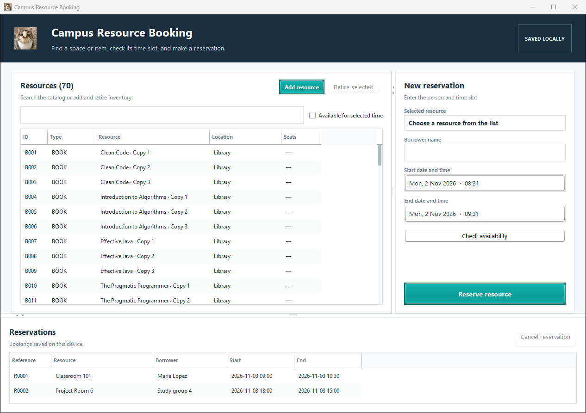

# Campus Resource Booking

A Java desktop app for reserving shared rooms, books and equipment. It uses Swing for the interface and a local SQLite database for the inventory and bookings.

Overlapping bookings are blocked twice: by the booking rules in Java and by a trigger in the database, so two bookings made at the same moment can't both get through. The window stays responsive because database work runs in the background, and JUnit tests cover the booking rules, time-slot edges and concurrent bookings.



The screenshot uses the built-in sample catalog and made-up bookings.

## What it does

- Browse and search the catalog, and filter it to the resources that are free for a chosen time slot.
- Refresh the catalog and bookings to see changes made in another app window.
- Book a resource for a future time slot, picking the date and time from a calendar picker, and cancel bookings.
- Add inventory, and retire items that have no active bookings.
- Reject overlapping bookings. A booking that starts exactly when another ends is allowed.

The sample catalog is made-up example data, not a real organization's inventory.

## How it's built

- `Resource` and `Reservation` are the data types. `BookingService` holds the booking, availability and inventory rules.
- `BookingRepository` defines the storage operations and `SQLiteBookingRepository` implements them with JDBC and prepared statements.
- A new booking gets its reference number and is inserted in one transaction. A SQLite trigger also rejects overlapping active bookings, so the database stays correct even if two bookings are attempted at once.
- Retired resources and cancelled bookings are flagged rather than deleted, so their records are kept.
- `BookingFrame` is the main window, `AddResourceDialog` handles new inventory, and `DateTimePickerDialog` is the date and time picker. Shared input and button styling lives in `UiStyles`. The panels use layout managers and split panes, so they resize with the window.
- Loading data and every write run in `SwingWorker`s, and the interface is only updated on the Event Dispatch Thread, so the window doesn't freeze while SQLite is working.
- The availability filter uses the loaded data for a quick answer. Refresh reloads the catalog and bookings; Check availability also fetches current data. Writes reload the local snapshot first, and the database has the final say on booking conflicts and retirement.

## Running it

You need JDK 17 or newer. The Maven wrapper downloads Maven and the SQLite JDBC driver on the first run.

```powershell
.\mvnw.cmd compile exec:java
```

The database is saved at `%USERPROFILE%\.resource-booking\bookings.db`.

## Tests

```powershell
.\mvnw.cmd verify
```

The tests cover normal bookings, rejecting past times and bad input, conflicts at the edges of a time slot, the availability filter, cancelling, adding and retiring inventory, data surviving a database reopen, unique reference numbers, and two overlapping bookings attempted at the same time.

## Limitations

- Data stays on one computer and one Windows user account; nothing is synced between computers. Open windows do not update live: use Refresh to see changes made in another window.
- There are no user accounts or permissions, opening hours or per-resource loan periods.
- Retired resources and cancelled bookings stay in the database but aren't shown in the interface.

## License

MIT. See [LICENSE](LICENSE). The SQLite JDBC driver is from [Xerial](https://github.com/xerial/sqlite-jdbc). The cat artwork is used for the app and date-picker icons; the `.ico` version can be used for Windows shortcuts.
